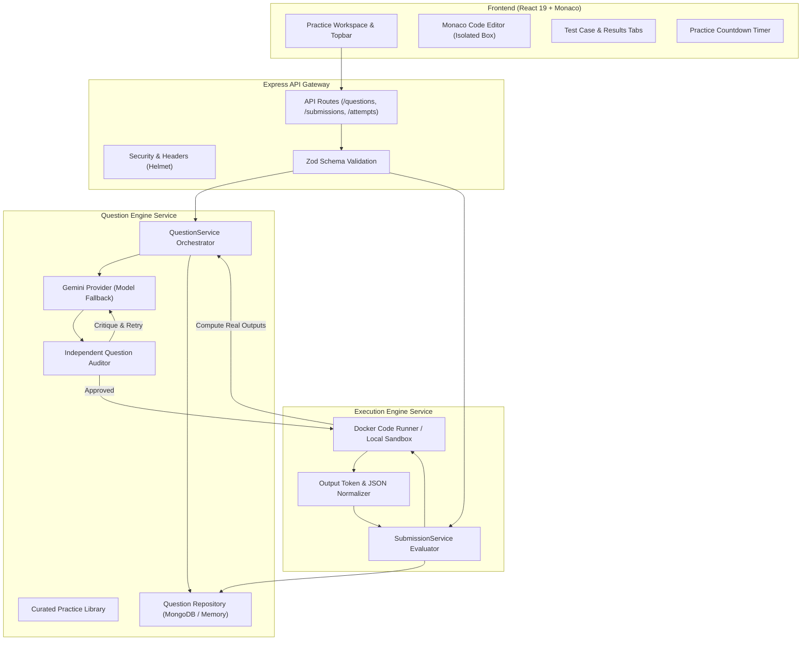

# Platform Architecture

## Overview

TestMeMan is built as a modular monorepo combining an interactive React 19 frontend with a resilient Express TypeScript API, backed by a dual-engine question pipeline and an isolated code execution runner.

---

## Architecture Diagram



---

## 6-Stage AI Generation & Verification Pipeline

```text
1. User Selects Category & Difficulty (Arrays, DP, Graphs | Easy, Medium, Hard)
                      ↓
2. Gemini Generates Problem Specification (Statement, Raw Stdin Tests, Python Reference Code)
                      ↓
3. Independent Question Auditor (Gemini Senior CP Judge: cycles, inequalities, math invariants)
                      ↓ (Critique looped back if rejected)
4. Backend Executes Python Reference Code in Sandbox
                      ↓
5. Validate & Compute Authentic Expected Outputs (0% hallucinated test answers)
                      ↓
6. Save Verified Question to Database (Hidden outputs redacted from public responses)
```

---

## Component Boundaries

### 1. Frontend (`apps/web`)
- Monaco Editor encapsulated in `.code-area-inner` with `position: absolute; inset: 0;` to guarantee flex containment and prevent layout overflow.
- Dual Run and Submit buttons (top editor toolbar and bottom pinned footer).
- Quick keyboard shortcut listeners (`Ctrl + Enter` to run, `Esc` to close modals).
- Real-time client timer synchronizing with server-side attempt expiry.

### 2. API Server (`apps/api`)
- Thin controllers backed by domain services.
- `pino-http` logging and `helmet` security middleware.
- Structured error handling with standardized HTTP error classes (`HttpError`).

### 3. Question Engine (`services/question-engine`)
- `geminiProvider.ts`: Model fallback across `gemini-3.5-flash-lite`, `gemini-flash-lite-latest`, `gemini-3.5-flash`, `gemini-3.8-flash`.
- `questionAuditor.ts`: Independent competitive programming verification prompt.
- `curatedQuestions.ts`: Production offline library across Stacks, DP, and Arrays.
- `questionRepository.ts`: Dual MongoDB and in-memory persistence with hidden output redaction.

### 4. Execution Engine (`services/execution-engine`)
- `submissionService.ts`: Universal raw stdin tokenization and multi-language evaluation.
- `dockerCodeRunner.ts`: Sandboxed container execution with CPU, memory, and timeout controls.
- Output comparison modes: `token` (whitespace-neutral), `exact` (preserves line structure), and `json` (deep value equivalence).

### 5. Shared Contracts (`packages/shared`)
- Unified TypeScript interfaces (`QuestionDto`, `SubmissionResultDto`, `AttemptDto`, `ProgrammingLanguage`).
- Shared input validation schemas across frontend and backend.
